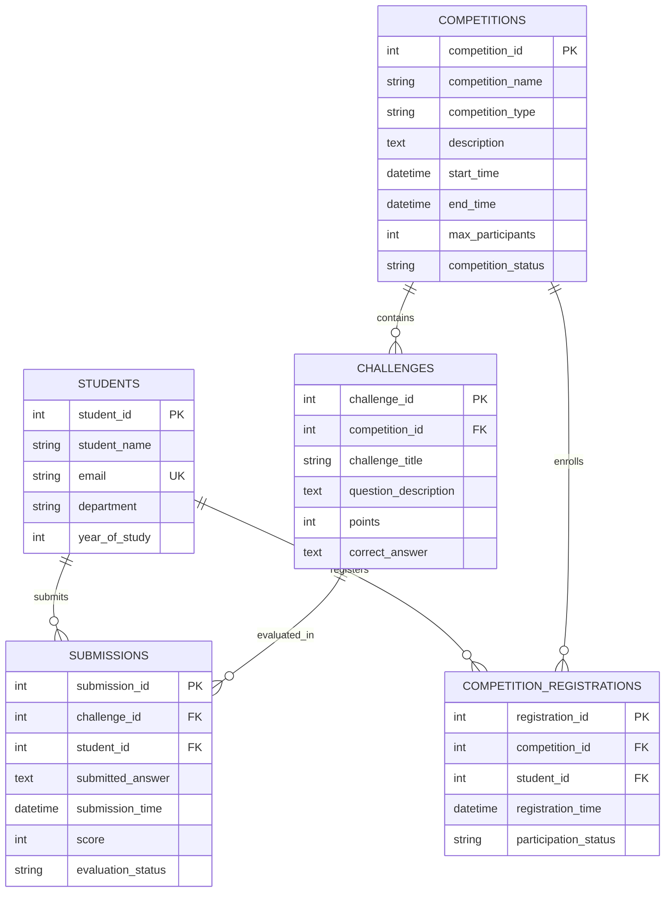

# 🏆 Campus Challenge Arena
### *Centralized College Competition & Live Leaderboard Platform*


---

## 📌 Overview

**Campus Challenge Arena** is a centralized, end-to-end web platform built to manage collegiate hackathons, algorithmic coding sprints, technical quizzes, and department competitions.

Traditional campus events frequently suffer from fragmented tools—Google Forms for signups, spreadsheets for scoring, and offline announcements for results. Campus Challenge Arena consolidates the entire tournament lifecycle into a single high-performance system:
- **Live Interactive Arena** for contestants to solve challenges and submit answers.
- **Automated Instant Evaluation & Dynamic Leaderboards** computed on relational SQL queries.
- **Organizer Command Center** to publish contests, add challenges, manage registrations, and review submissions.
- **Historical Archives** preserving past champion standings and challenge analytics.

---

## ✨ Core Features

### 1. ⚔️ Live Challenge Arena
- **Real-Time Problem Solving**: Browse active contest challenges with descriptions, point allocations, and submission forms.
- **Automated Validation**: Instant answer verification against test criteria with real-time scoring updates.
- **Anti-Duplication**: Prevents duplicate score inflation while logging all historical submission attempts.

### 2. 📊 Dynamic Live Leaderboards
- **Per-Competition Standings**: Ranked by cumulative score, solved count, and earliest submission timestamps (tie-breaking logic).
- **Global Hall of Fame**: Aggregated cross-competition leaderboard tracking overall student dominance across departments.
- **Neo-Brutalist Visual Badges**: Visual podium highlights (🥇 Gold, 🥈 Silver, 🥉 Bronze) and department breakdowns.

### 3. 🎯 Competition Directory & Lifecycle
- **Status Filtering**: Seamlessly filter between `UPCOMING`, `ACTIVE`, and `COMPLETED` events.
- **Capacity Management**: Enforces configurable `max_participants` caps per competition.
- **One-Click Registration**: Instant participant enrollment linked to student records.

### 4. 🛠️ Organizer Command Hub
- **Contest Creation**: Define competition title, category, description, start/end timestamps, and participant limits.
- **Challenge Builder**: Create challenge questions, point weightings, and ground-truth answer keys.
- **Lifecycle Control**: Transition contest states between `UPCOMING` ➔ `ACTIVE` ➔ `COMPLETED`.
- **Submission Evaluation**: Monitor contestant progress with manual score override and re-evaluation capabilities.

### 5. 👥 Student Profiles & Directory
- Maintain complete records: Name, Institutional Email, Department, and Academic Year.
- Detailed student transcripts showing registered competitions, submitted answers, and earned points.

### 6. ⚡ System Health & Instant Demo Seeding
- **One-Click Seeder**: Pre-populates the database with realistic sample students, competitions, challenges, registrations, and submissions via `/api/system/reset-seed`.
- Built-in schema verification with automatic table generation on startup.

---

## 🏗️ Architecture & Relational Design

The backend uses a clean, layered Spring architecture with Spring `JdbcTemplate` for direct, transparent relational database management without heavy ORM overhead.

```
                           ┌───────────────────────────────┐
                           │      Web Browser / Client     │
                           │  Single-Page Neo-Brutalist UI │
                           └───────────────┬───────────────┘
                                           │ HTTP / JSON
                                           ▼
                           ┌───────────────────────────────┐
                           │      REST Controllers         │
                           │  /api/{competitions, etc.}    │
                           └───────────────┬───────────────┘
                                           │
                                           ▼
                           ┌───────────────────────────────┐
                           │       Service Layer           │
                           │ Business Logic & Validation   │
                           └───────────────┬───────────────┘
                                           │
                                           ▼
                           ┌───────────────────────────────┐
                           │     Data Access Objects       │
                           │     Spring JdbcTemplate       │
                           └───────────────┬───────────────┘
                                           │ SQL Queries & Aggregations
                                           ▼
                           ┌───────────────────────────────┐
                           │        MySQL Database         │
                           │       campus_challenge        │
                           └───────────────────────────────┘
```

### Entity Relationship (ER) Diagram



### Relational Schema Highlights
- **Primary & Foreign Keys**: All tables maintain strict referential integrity with `ON DELETE CASCADE` on child records.
- **Compound Unique Constraints**: `uk_competition_student (competition_id, student_id)` ensures a student cannot register more than once for the same contest.
- **Complex Aggregations**: Leaderboards utilize SQL `SUM()`, `COUNT()`, `MAX()`, and `GROUP BY` with multi-table joins across `STUDENTS`, `SUBMISSIONS`, and `CHALLENGES`.

---

## 💻 Tech Stack

| Layer | Technology | Details |
|---|---|---|
| **Backend Framework** | Spring Boot 3.3.4 | RESTful Services, Dependency Injection, Validation |
| **Language** | Java 17 | Modern LTS Java |
| **Data Access** | Spring JDBC (`JdbcTemplate`) | High-performance direct SQL execution & mapping |
| **Connection Pooling** | HikariCP | Low-latency production database connection pool |
| **Database** | MySQL 8.0+ | ACID-compliant Relational Database |
| **Frontend** | HTML5, Vanilla JavaScript, CSS3 | Neo-Brutalist design, mobile-responsive layout |
| **Typography** | Space Grotesk, Inter, Bebas Neue | Google Fonts |
| **Build & Dependency** | Apache Maven | Maven Wrapper (`./mvnw`) included |

---

## 🚀 Getting Started

### Prerequisites
Ensure you have the following installed on your machine:
- **Java Development Kit (JDK) 17** or higher: `java -version`
- **MySQL Server 8.0+**: `mysql --version`
- **Git**: `git --version`

---

### Step 1: Database Setup

1. Start your local MySQL service:
   ```bash
   sudo systemctl start mysql
   # Or on macOS / Windows via service manager
   ```

2. Log into MySQL CLI:
   ```bash
   mysql -u root -p
   ```

3. Create the database and dedicated application user (or use existing credentials):
   ```sql
   CREATE DATABASE IF NOT EXISTS campus_challenge;

   -- Optional: Create developer user matching default application.properties
   CREATE USER IF NOT EXISTS 'developer'@'localhost' IDENTIFIED BY '123';
   GRANT ALL PRIVILEGES ON campus_challenge.* TO 'developer'@'localhost';
   FLUSH PRIVILEGES;
   ```

---

### Step 2: Configure Application Properties

Review `src/main/resources/application.properties` and verify your MySQL connection settings:

```properties
spring.application.name=Campus-Challenge-Arena
server.port=8080

# MySQL DataSource
spring.datasource.url=jdbc:mysql://localhost:3306/campus_challenge?createDatabaseIfNotExist=true&useSSL=false&allowPublicKeyRetrieval=true&serverTimezone=UTC
spring.datasource.username=developer
spring.datasource.password=123
spring.datasource.driver-class-name=com.mysql.cj.jdbc.Driver

# Connection Pool
spring.datasource.hikari.maximum-pool-size=10
spring.datasource.hikari.minimum-idle=2
```

> **Note:** Update `spring.datasource.username` and `spring.datasource.password` if using your own MySQL credentials.

---

### Step 3: Build and Run

1. Clone or navigate to the repository directory:
   ```bash
   cd Campus-Challenge-Arena
   ```

2. Build and launch the Spring Boot application using the Maven Wrapper:
   ```bash
   ./mvnw clean spring-boot:run
   ```
   *(On Windows Command Prompt: `mvnw.cmd clean spring-boot:run`)*

3. Once started, you will see the log output:
   ```
   INFO: Started CampusChallengeArenaApplication in X.XXX seconds
   ```

4. Open your browser and navigate to:
   ```
   http://localhost:8080
   ```

---

## 📡 REST API Reference

All responses follow a consistent JSON envelope:
```json
{
  "success": true,
  "message": "Operation completed successfully",
  "data": { ... }
}
```

### Competitions
| Method | Endpoint | Description |
|---|---|---|
| `GET` | `/api/competitions` | Fetch all competitions |
| `GET` | `/api/competitions/summaries` | Fetch competitions with registered/submission counts |
| `GET` | `/api/competitions/{id}` | Fetch a specific competition by ID |
| `POST` | `/api/competitions` | Create a new competition |
| `PUT` | `/api/competitions/{id}/status` | Update competition status (`UPCOMING`, `ACTIVE`, `COMPLETED`) |

### Challenges
| Method | Endpoint | Description |
|---|---|---|
| `GET` | `/api/challenges/competition/{competitionId}` | List all challenges for a competition |
| `GET` | `/api/challenges/{id}` | Fetch a specific challenge |
| `POST` | `/api/challenges` | Add a new challenge to a competition |
| `DELETE` | `/api/challenges/{id}` | Remove a challenge |

### Students
| Method | Endpoint | Description |
|---|---|---|
| `GET` | `/api/students` | List all registered students |
| `GET` | `/api/students/{id}` | Get student details |
| `POST` | `/api/students` | Register a new student profile |

### Registrations
| Method | Endpoint | Description |
|---|---|---|
| `POST` | `/api/registrations` | Register a student for a competition |
| `GET` | `/api/registrations/competition/{competitionId}` | Get registered students for a contest |
| `GET` | `/api/registrations/student/{studentId}` | Get all registrations for a student |
| `GET` | `/api/registrations/check?competitionId=&studentId=` | Check enrollment status |

### Submissions & Evaluation
| Method | Endpoint | Description |
|---|---|---|
| `POST` | `/api/submissions` | Submit challenge solution (auto-evaluates points) |
| `GET` | `/api/submissions/competition/{competitionId}` | Get all submissions in a competition |
| `GET` | `/api/submissions/student/{studentId}/competition/{competitionId}` | Student's submissions for a contest |
| `POST` | `/api/submissions/{id}/evaluate` | Manually evaluate or override score |

### Leaderboard & History
| Method | Endpoint | Description |
|---|---|---|
| `GET` | `/api/leaderboard/competition/{competitionId}` | Ranked leaderboard for a competition |
| `GET` | `/api/leaderboard/global` | Global hall-of-fame across all tournaments |
| `GET` | `/api/history` | List completed tournaments with statistics |
| `GET` | `/api/history/{competitionId}` | Tournament history archive and winners |

### System & Testing
| Method | Endpoint | Description |
|---|---|---|
| `GET` | `/api/system/stats` | System counts (students, contests, submissions) |
| `POST` | `/api/system/reset-seed` | Reset database and seed fresh sample data |

---

## 📂 Project Structure

```
Campus-Challenge-Arena/
├── pom.xml                               # Maven Project Dependencies
├── mvnw / mvnw.cmd                       # Maven Wrapper Executables
├── src/
│   ├── main/
│   │   ├── java/com/example/DBMS_MiniProject_/Campus_Challenge_Arena/
│   │   │   ├── CampusChallengeArenaApplication.java # Spring Boot Entrypoint
│   │   │   ├── controller/               # REST API Controllers
│   │   │   │   ├── CompetitionController.java
│   │   │   │   ├── ChallengeController.java
│   │   │   │   ├── StudentController.java
│   │   │   │   ├── RegistrationController.java
│   │   │   │   ├── SubmissionController.java
│   │   │   │   ├── LeaderboardController.java
│   │   │   │   ├── HistoryController.java
│   │   │   │   └── SystemController.java
│   │   │   ├── service/                  # Business Logic Layer
│   │   │   │   ├── CompetitionService.java
│   │   │   │   ├── ChallengeService.java
│   │   │   │   ├── StudentService.java
│   │   │   │   ├── RegistrationService.java
│   │   │   │   ├── SubmissionService.java
│   │   │   │   ├── LeaderboardService.java
│   │   │   │   ├── CompetitionHistoryService.java
│   │   │   │   └── DatabaseInitService.java # Auto-seed & Schema Runner
│   │   │   ├── dao/                      # Data Access Objects (JdbcTemplate)
│   │   │   │   ├── CompetitionDao.java
│   │   │   │   ├── ChallengeDao.java
│   │   │   │   ├── StudentDao.java
│   │   │   │   ├── RegistrationDao.java
│   │   │   │   ├── SubmissionDao.java
│   │   │   │   └── LeaderboardDao.java
│   │   │   ├── model/                    # Relational Entity Models
│   │   │   │   ├── Student.java
│   │   │   │   ├── Competition.java
│   │   │   │   ├── Challenge.java
│   │   │   │   ├── CompetitionRegistration.java
│   │   │   │   └── Submission.java
│   │   │   └── dto/                      # Data Transfer Objects
│   │   │       ├── ApiResponse.java
│   │   │       ├── CompetitionSummary.java
│   │   │       └── LeaderboardEntry.java
│   │   └── resources/
│   │       ├── application.properties    # Configuration (Port, MySQL, Logging)
│   │       ├── schema.sql                # DDL Schema definitions
│   │       └── static/                   # Frontend SPA
│   │           ├── index.html            # Main Neo-Brutalist Layout
│   │           └── app.js                # Frontend Controller & API Client
│   └── test/                             # Unit & Integration Tests
└── README.md                             # Documentation
```

---

## 🧪 Testing the Application

### 1. Web Interface
Visit `http://localhost:8080` in any browser. You can immediately:
1. Switch to the **Arena** tab to view the active competition (*Apex CodeSprint 2026*).
2. Choose a student from the dropdown and submit challenge answers.
3. Observe live score calculation and leaderboard shifts.
4. Open the **Organizer Hub** to change competition states or add brand new challenges.

### 2. cURL Verification
Test the health and registration endpoints directly from the terminal:

```bash
# Check system statistics
curl -X GET http://localhost:8080/api/system/stats

# Fetch all active and upcoming competitions
curl -X GET http://localhost:8080/api/competitions

# View current Global Leaderboard
curl -X GET http://localhost:8080/api/leaderboard/global
```

---

## 🔮 Future Enhancements
- [ ] **Automated Code Sandbox**: Integration with Judge0 / Docker containers for multi-language execution (Python, C++, Java).
- [ ] **WebSocket Broadcasts**: Real-time push updates for leaderboard recalculations without polling.
- [ ] **Role-Based Authentication**: JWT-based authentication for college organizers, faculty judges, and students.
- [ ] **Team Competitions**: Support for multi-student team registrations and collective submissions.

---

## 📜 License & Academic Context
Developed as a **Database Management Systems (DBMS) Mini-Project** to demonstrate core relational database principles, high-concurrency connection pooling, parameterized query safety, and responsive full-stack integration.
